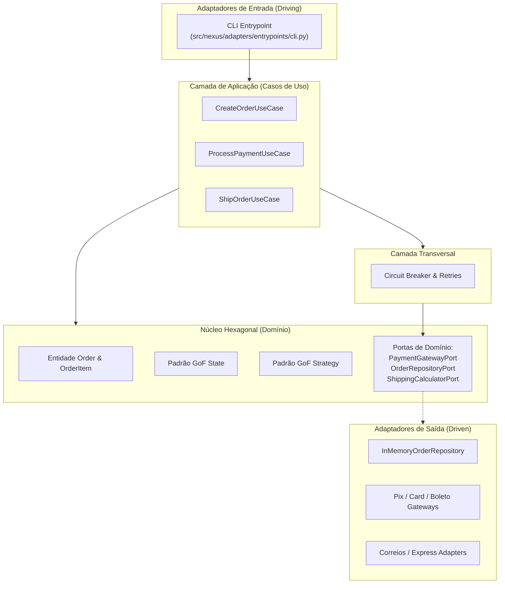
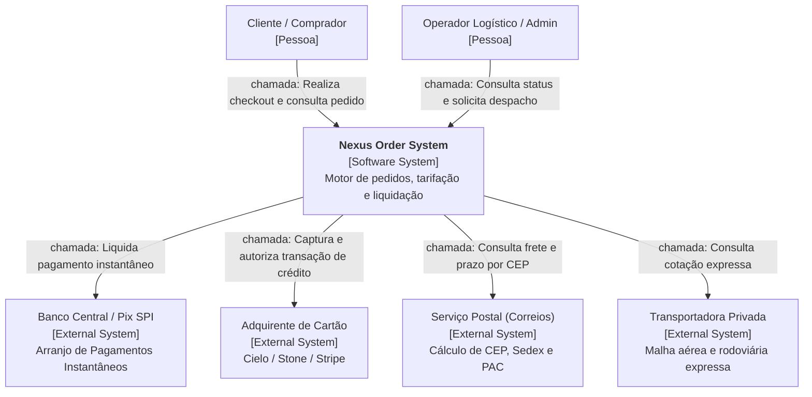
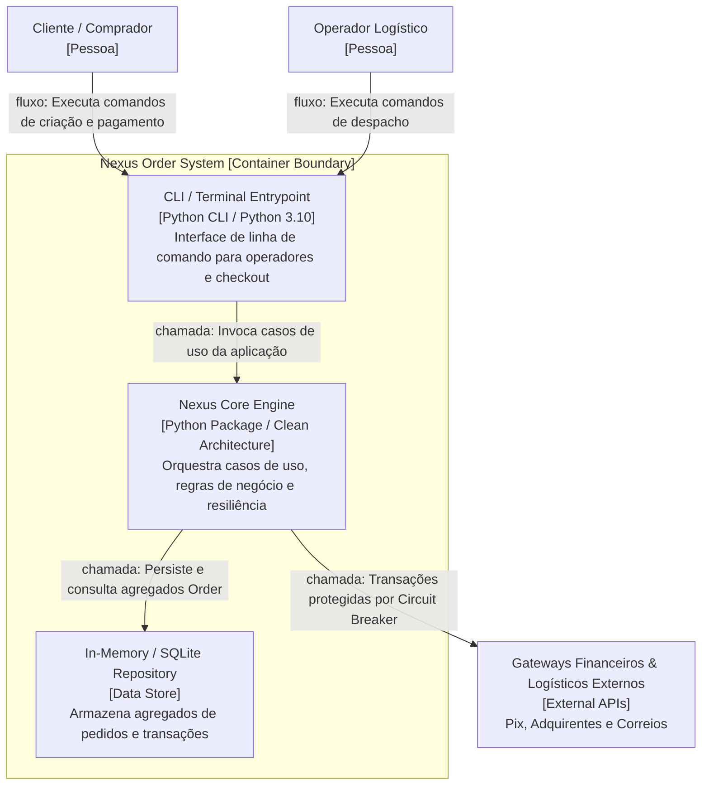
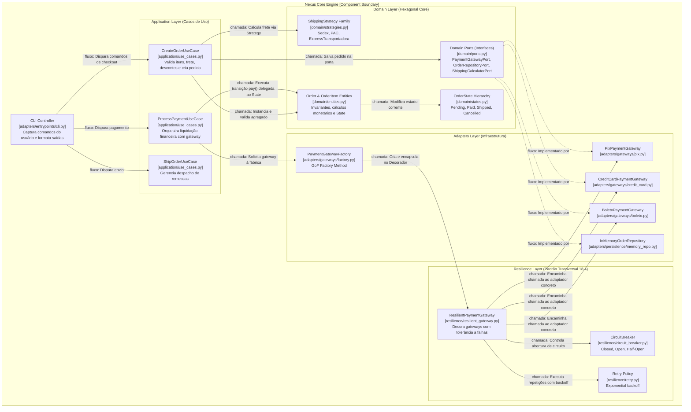
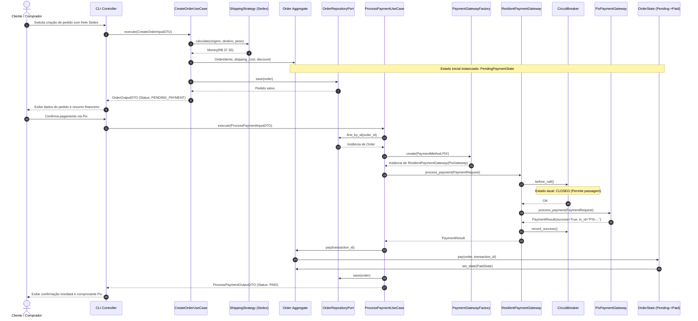

# 3. Arquitetura do Sistema

## 3.1 Plano Macro: Monolito Modular
A macroestrutura do Nexus Order System adota o estilo **Monolito Modular** (Capítulo 5 do livro da disciplina). Todos os módulos funcionais (Pedidos, Tarifação de Frete, Liquidação Multigateway e Resiliência) coexistem na mesma base de código e rodam sob um único processo de aplicação, organizados com fronteiras lógicas estritas.

### Justificativa Baseada no Livro da Disciplina:
* **Quando Adotar (Seção do Livro):** É recomendado quando a equipe é pequena/focada, o domínio de negócio possui alta coesão e há necessidade de forte consistência transacional entre as etapas (ex: reservar estoque, aplicar frete e liquidar transação sem a sobrecarga de transações distribuídas de duas fases ou padrões Saga complexos).
* **Quando Evitar (Seção do Livro):** Deve ser evitado quando diferentes áreas de negócio necessitam de ciclos de vida de deploy totalmente independentes, com centenas de engenheiros trabalhando simultaneamente e com tecnologias de hardware heterogêneas.
* **Custo Real (Seção do Livro):** A divisão prematura em microsserviços introduz custos reais elevados: observabilidade distribuída (tracing, logs correlacionados), complexidade de rede, latência adicional por salto de requisição, serialização de dados e custo de múltiplos ambientes em nuvem. O monolito modular elimina completamente esses custos na fase atual do projeto.

---

## 3.2 Plano Interno: Arquitetura Hexagonal (Ports & Adapters)
Internamente, o código é estruturado seguindo os princípios de Alistair Cockburn e da Clean Architecture (Capítulo 6):

### Mapeamento de Pastas e Componentes:
| Camada | Pasta do Código | Responsabilidade e Componentes |
| :--- | :--- | :--- |
| **Domain** | `src/nexus/domain/` | Entidades puras (`Order`, `OrderItem`), Objetos de Valor (`Money`, `Address`), Exceções explícitas (`exceptions.py`), Portas abstratas (`ports.py`), Estados GoF (`states.py`) e Estratégias GoF (`strategies.py`). Não possui dependência de frameworks. |
| **Application** | `src/nexus/application/` | Casos de Uso (`use_cases.py`: `CreateOrderUseCase`, `ProcessPaymentUseCase`, `ShipOrderUseCase`) e DTOs (`dtos.py`). Orquestram os fluxos chamando as portas do domínio. |
| **Resilience** | `src/nexus/resilience/` | Padrões transversais de resiliência: `CircuitBreaker`, `execute_with_retry` e o decorador `ResilientPaymentGateway`. |
| **Adapters** | `src/nexus/adapters/` | Implementações concretas de infraestrutura: adaptadores de gateways (`gateways/`), frete (`shipping/`), persistência em memória (`persistence/`) e CLI de entrada (`entrypoints/`). |

### Diagrama da Organização Interna:

---

## 3.3 Dois Estilos Considerados e Descartados

1. **Microsserviços Distribuídos (Capítulo 7 do livro):**
   * *Motivo do Descarte:* Introduziria desnecessariamente complexidade de infraestrutura (service discovery, API gateways distribuídos, mensageria com RabbitMQ/Kafka, circuit breakers de rede de borda) e falhas parciais em cascata. Para o problema proposto, o ganho de desacoplamento físico não compensaria o custo operacional e cognitivo.
2. **Arquitetura em Camadas Tradicional com Dependência no Banco (MVC/Active Record - Capítulo 6):**
   * *Motivo do Descarte:* Em modelos tradicionais orientados a banco, as entidades herdam das classes de ORM e o domínio fica acoplado aos schemas do banco de dados, inviabilizando a Inversão de Dependência (DIP) e dificultando testes unitários rápidos e puros.

---

## 3.4 Diagramas C4 (Contexto, Contêineres e Componentes)

> **Nota:** Todos os conectores nos diagramas abaixo possuem rótulos explícitos de comunicação (`chamada`, `evento`, `fluxo`, `arquivo`), conforme exigido pelas diretrizes da disciplina e pelo Apêndice B.4.

### Nível 1: Diagrama de Contexto C4
Fonte em [`diagrams/c4-context.mmd`](../diagrams/c4-context.mmd)

---

### Nível 2: Diagrama de Contêineres C4
Fonte em [`diagrams/c4-container.mmd`](../diagrams/c4-container.mmd)

---

### Nível 3: Diagrama de Componentes C4
Fonte em [`diagrams/c4-component.mmd`](../diagrams/c4-component.mmd)

---

## 3.5 Diagrama de Sequência: Fluxo Central de Checkout
Fonte em [`diagrams/sequence-checkout.mmd`](../diagrams/sequence-checkout.mmd)

