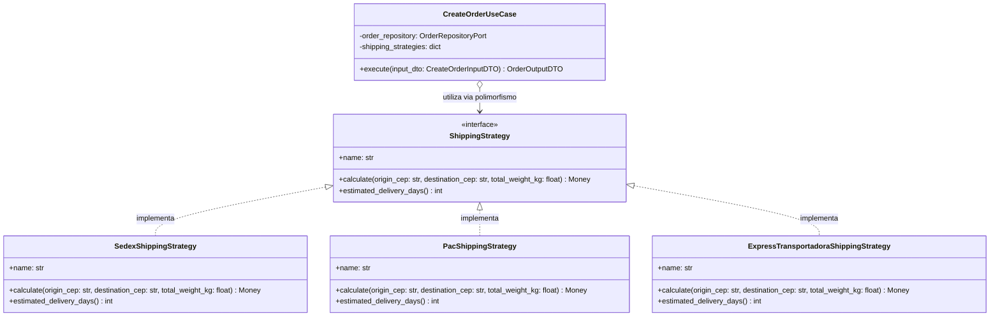
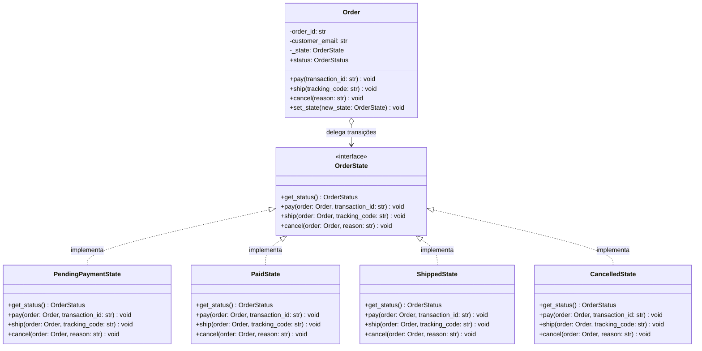
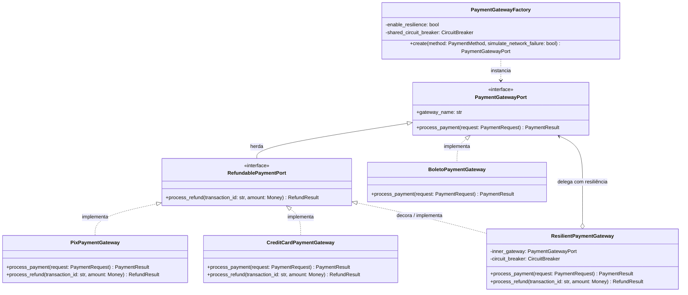

# 6. Padrões de Projeto GoF (Gang of Four)

Aplicamos **três padrões GoF** no Nexus Order System, cobrindo categorias **Comportamental** e **Criação**. Todos os nomes seguem exatamente a nomenclatura do catálogo oficial do **Refactoring Guru**.

---

## 6.1 Padrão 1: Strategy (Comportamental)

* **Referência:** [Refactoring Guru - Strategy](https://refactoring.guru/pt-br/design-patterns/strategy)
* **Categoria:** Padrão Comportamental

### Problema Concreto no Projeto
O cálculo do frete de um pedido depende da modalidade de envio escolhida pelo cliente e da operadora logística (Correios Sedex, Correios PAC ou Transportadora Expressa Privada). Cada modalidade possui fórmulas distintas: taxas base diferentes, cobrança progressiva por quilograma e acréscimo interestadual por primeiro dígito de CEP. Se implementássemos essa lógica por meio de condicionais `if modalidade == "SEDEX": ... elif ...`, qualquer nova transportadora exigiria modificar classes já testadas, violando o princípio OCP e gerando um método gigantesco difícil de manter.

### Trecho de Código
```python
# Trecho de src/nexus/domain/strategies.py
class ShippingStrategy(ABC):
    @property
    @abstractmethod
    def name(self) -> str:
        """Nome identificador da modalidade de envio."""

    @abstractmethod
    def calculate(self, origin_cep: str, destination_cep: str, total_weight_kg: float) -> Money:
        """Calcula o valor do frete."""

class SedexShippingStrategy(ShippingStrategy):
    @property
    def name(self) -> str:
        return "CORREIOS_SEDEX"

    def calculate(self, origin_cep: str, destination_cep: str, total_weight_kg: float) -> Money:
        base_rate = Decimal("25.00")
        weight_rate = Decimal(str(total_weight_kg)) * Decimal("6.50")
        interstate_fee = Decimal("10.00") if origin_cep[0] != destination_cep[0] else Decimal("0.00")
        return Money(amount=base_rate + weight_rate + interstate_fee)
```
Link: [`src/nexus/domain/strategies.py#L17-L44`](https://github.com/Pamorimd/nexus-order-system/blob/main/src/nexus/domain/strategies.py#L17-L44)

### Diagrama de Classes (Mermaid)
Fonte em [`diagrams/gof-strategy.mmd`](../diagrams/gof-strategy.mmd)



### Benefício e Custo
* **Benefício:** Novos algoritmos de frete ou de campanhas promocionais podem ser adicionados sem tocar no código de criação do pedido. Testes unitários para cada fórmula de frete rodam de forma 100% isolada.
* **Custo:** Aumento no número total de classes no projeto e a necessidade de registrar as estratégias em um mapa de busca na camada de aplicação.

---

## 6.2 Padrão 2: State (Comportamental)

* **Referência:** [Refactoring Guru - State](https://refactoring.guru/pt-br/design-patterns/state)
* **Categoria:** Padrão Comportamental

### Problema Concreto no Projeto
O ciclo de vida do pedido atravessa estados bem definidos: `PENDING_PAYMENT`, `PAID`, `SHIPPED` e `CANCELLED`. As regras de negócio impõem transições rígidas: um pedido pendente **não pode** ser despachado antes de ser pago; um pedido despachado **não pode** ser cancelado diretamente por API simples; e um pedido cancelado é terminal. Tratar essas regras com verificações condicionais dentro de cada método de `Order` tornaria a entidade um labirinto de `if self.status == ...`, propenso a falhas onde uma validação esquecida permitiria despachar um pedido não pago.

### Trecho de Código
```python
# Trecho de src/nexus/domain/states.py
class PendingPaymentState(OrderState):
    def pay(self, order: Order, transaction_id: str) -> None:
        order.transaction_id = transaction_id
        order.set_state(PaidState())

    def ship(self, order: Order, tracking_code: str) -> None:
        raise InvalidStateTransitionError(
            "Regra violada: Impossível despachar um pedido que ainda não foi pago."
        )

    def cancel(self, order: Order, reason: str) -> None:
        order.cancellation_reason = reason
        order.set_state(CancelledState())
```
Link: [`src/nexus/domain/states.py#L35-L51`](https://github.com/Pamorimd/nexus-order-system/blob/main/src/nexus/domain/states.py#L35-L51)

E a entidade `Order` apenas delega para o estado corrente:
```python
# Trecho de src/nexus/domain/entities.py
def ship(self, tracking_code: str) -> None:
    """Despacha o pedido delegando a transição ao estado corrente."""
    self._state.ship(self, tracking_code)
```
Link: [`src/nexus/domain/entities.py#L90-L93`](https://github.com/Pamorimd/nexus-order-system/blob/main/src/nexus/domain/entities.py#L90-L93)

### Diagrama de Classes (Mermaid)
Fonte em [`diagrams/gof-state.mmd`](../diagrams/gof-state.mmd)



### Benefício e Custo
* **Benefício:** Elimina completamente blocos condicionais do ciclo de vida. Novas regras de transição (ex: estado `Devolvido` ou `Em Separação`) são criadas em classes autônomas sem risco de regredir os demais estados.
* **Custo:** Proliferação de quatro classes de estado adicionais e acoplamento mútuo entre as classes de estado e a entidade de contexto `Order`.

---

## 6.3 Padrão 3: Factory Method (Criação)

* **Referência:** [Refactoring Guru - Factory Method](https://refactoring.guru/pt-br/design-patterns/factory-method)
* **Categoria:** Padrão de Criação

### Problema Concreto no Projeto
O caso de uso `ProcessPaymentUseCase` não deve conhecer os detalhes de instanciação dos adaptadores concretos de pagamento (`PixPaymentGateway`, `CreditCardPaymentGateway` ou `BoletoPaymentGateway`), tampouco saber se eles devem ser envelopados pelo decorador de resiliência (`ResilientPaymentGateway`) com circuit breaker compartilhado. Se a instanciação ocorresse diretamente no caso de uso com comandos `new/instância`, a camada de aplicação ficaria fortemente acoplada às classes de infraestrutura, violando o DIP.

### Trecho de Código
```python
# Trecho de src/nexus/adapters/gateways/factory.py
class PaymentGatewayFactory:
    """Fábrica de adaptadores de pagamento com suporte a resiliência configurável."""

    def create(
        self,
        method: PaymentMethod,
        simulate_network_failure: bool = False,
    ) -> PaymentGatewayPort:
        if method == PaymentMethod.PIX:
            raw_gateway = PixPaymentGateway(simulate_network_failure=simulate_network_failure)
        elif method == PaymentMethod.CREDIT_CARD:
            raw_gateway = CreditCardPaymentGateway(simulate_network_failure=simulate_network_failure)
        elif method == PaymentMethod.BOLETO:
            raw_gateway = BoletoPaymentGateway(simulate_network_failure=simulate_network_failure)
        else:
            raise ValueError(f"Método de pagamento não suportado: {method}")

        if self.enable_resilience:
            return ResilientPaymentGateway(
                inner_gateway=raw_gateway,
                circuit_breaker=self.shared_circuit_breaker or CircuitBreaker(),
            )
        return raw_gateway
```
Link: [`src/nexus/adapters/gateways/factory.py#L29-L55`](https://github.com/Pamorimd/nexus-order-system/blob/main/src/nexus/adapters/gateways/factory.py#L29-L55)

### Diagrama de Classes (Mermaid)
Fonte em [`diagrams/gof-factory.mmd`](../diagrams/gof-factory.mmd)



### Benefício e Custo
* **Benefício:** Centraliza as decisões de instanciação e a aplicação transparente do decorador de resiliência. O caso de uso recebe diretamente um objeto que respeita `PaymentGatewayPort`, sem saber se ele é real, resiliente ou mock.
* **Custo:** Adiciona mais uma classe intermediária que precisa ser injetada na inicialização do sistema.
